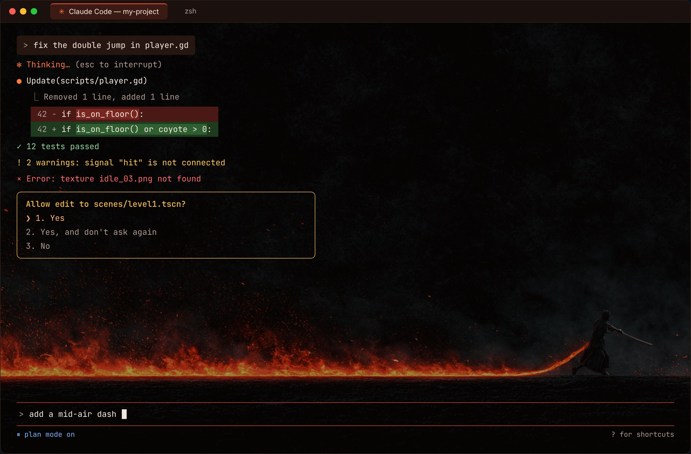
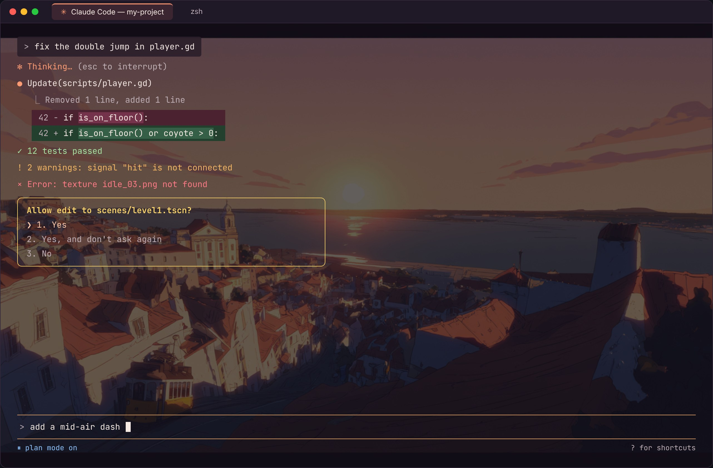
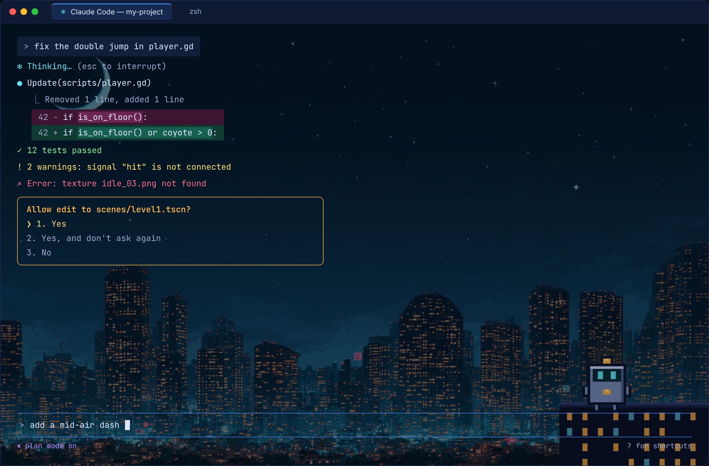
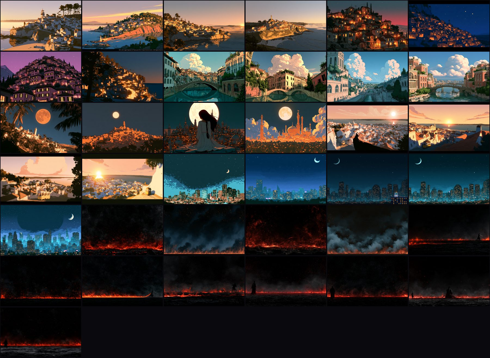
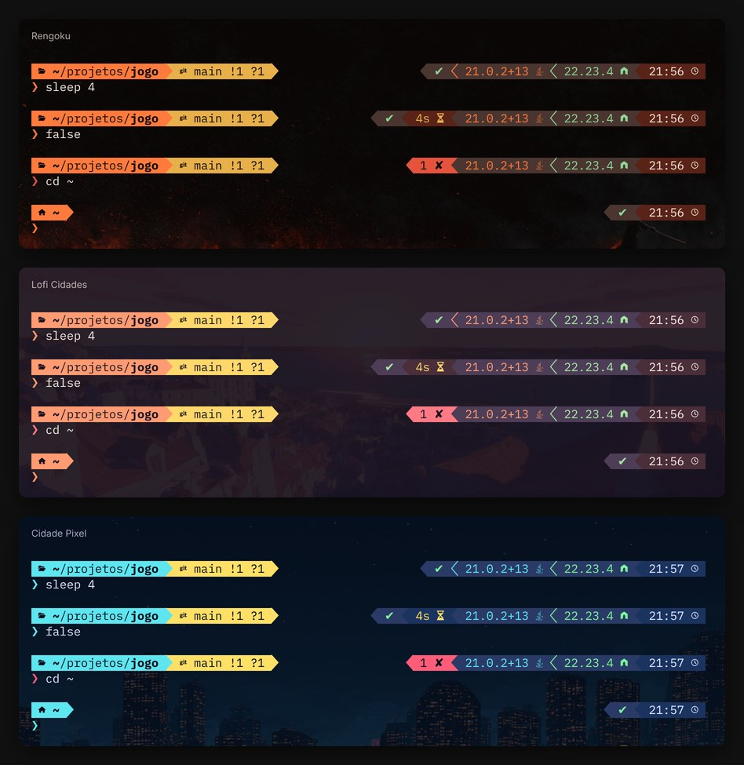

# Themes for Claude Code + iTerm2

**English** · [Português](README.pt.md)

Three themes for people who use **Claude Code** in **iTerm2** (Mac): a background image in the terminal window and matching colors, both in the terminal and in Claude Code.

They also come with two commands you can use inside Claude Code:

- **`/tema`** switches the whole theme (background and colors) without closing anything.
- **`/fundo`** switches only the background image.

> The commands and the theme names are in Portuguese (*tema* = theme, *fundo* = background). They work the same for everyone.

## What the terminal looks like

### Rengoku
Embers, smoke and a samurai facing the fire. Warm orange for Claude, gold for permission prompts.



### Lofi Cidades (Lofi Cities)
Lisbon and made-up cities, from dawn to night. Coral for Claude, yellow for permission prompts.



### Cidade Pixel (Pixel City)
A pixel-art city at night, with a little robot sitting on a rooftop. Cyan for Claude, amber for permission prompts.



<sub>Illustrative images. On your Mac, how bright the background looks depends on the window size and on iTerm2's "Blending" setting.</sub>

## All the backgrounds

There are 37 backgrounds in total: 12 for Rengoku, 20 for Lofi Cidades and 5 for Cidade Pixel (one of them with the robot). There are also darker versions of two of them, used as the default backgrounds.



---

## What you need

- A **Mac**.
- **[iTerm2](https://iterm2.com)**. The Mac's built-in Terminal can't show background images.
- **[Claude Code](https://code.claude.com)**, version 2.1.118 or newer (the one that added custom themes). To check your version: `claude --version`.

## How to install

**1. Download this folder.** Pick one way:

- **With Git**, in the Terminal:
  ```bash
  git clone https://github.com/joaocalixto/temas-claude-code.git ~/temas-claude-code
  ```
- **Without Git:** click the green **Code → Download ZIP** button, open the ZIP and put the folder somewhere it will stay (for example, your home folder).

> Don't delete or move the folder after installing: the background images are read from there. If you move it, run the installer again.

**2. Run the installer.** Inside the folder, double-click **`instalar.command`** (*instalar* = install).
If your Mac says it can't open it, right-click it → **Open** → **Open**.
You can also run it in the Terminal: `~/temas-claude-code/instalar.command`.

**3. Open iTerm2.** Quit and reopen iTerm2 (so it sees the new font).
For new tabs to open with a theme, it has to be iTerm2's default profile: **Settings → Profiles**, select the profile, click **Other Actions… → Set as Default**.
The handiest choice is **"Claude · Último"** (*último* = last), which the installer creates: it always copies the last theme you picked with `/tema`. If iTerm2 is closed while you install, the installer makes it the default for you.

**4. Pick the theme in Claude Code.** Close and reopen Claude Code (so it sees the new commands) and type `/tema pixel` (or `lofi`, or `rengoku`).

That's it. `/tema` changes iTerm2 and Claude Code at the same time, so you don't need Claude Code's own `/theme` menu.

## How to use

Inside Claude Code:

| Command | What it does |
|---|---|
| `/tema pixel` | Switches to Cidade Pixel |
| `/tema lofi` | Switches to Lofi Cidades |
| `/tema rengoku` | Switches to Rengoku |
| `/tema aleatorio` | Picks one of the three themes at random (*aleatório* = random) |
| `/tema lista` | Lists the themes |
| `/fundo lista` | Lists all the backgrounds |
| `/fundo lisboa 2` | Switches to the background that has those words in its name |
| `/fundo robo` | Goes back to Cidade Pixel with the robot |
| `/fundo aleatorio` | Picks a random background |
| `/fundo nenhum` | Removes the background image |
| `/fundo original` | Goes back to the background the theme ships with |
| `/tema-teste` | Shows a sample of everything the theme colors: the 16 terminal colors, text styles, icons, a code diff, a task list, headings, lists, a table and code blocks (*teste* = test) |

- `/fundo` changes the tab you're in and saves the image as that tab's **theme default background**. For example, `/fundo lisboa 2` in a Lofi Cidades tab makes every new Lofi Cidades tab open with Lisbon. Other open tabs with that theme change too.
- Each theme remembers its background: if you go back to a theme with `/tema`, it shows the last background you gave it.
- Your choices are kept when you update and run the installer again.
- `/tema-teste` creates a small test file in `/tmp/tema-teste/` (not in your project), so Claude Code may ask for permission: that prompt is part of the test too.
- The first time you use `/fundo`, iTerm2 asks for permission to change the image. Choose **Allow**.

## What the theme changes

**In iTerm2** (the "Claude · ..." profiles):

- **Background image**, darkened just enough for the text to be easy to read.
- **Tab color**, different for each theme.
- **"Claude · Último"**, an extra profile that copies the last theme you picked with `/tema`.
- **The 16 terminal colors**, the ones Git and other programs use.
- **Cursor and selection colors.**
- **Font: IBM Plex Mono** (the Nerd Font version, called "BlexMono"), a sober typeface. It comes in the `fonte/` folder and the installer adds it to your Mac. It has the icons that prompts like Powerlevel10k and Oh My Zsh use.
- Everything else comes from your **Default** profile.

**In Claude Code:** the colors of Claude, the box you type in, permission prompts, plan mode, errors, warnings, and added and removed lines in code.

**In the Powerlevel10k prompt** (only if you already use it): colored blocks with the folder, git, ✔ or ✘ for the last command, how long it took (from 3 seconds up), the Java or Node version (only inside projects in those languages) and the time. The colors follow the theme and change on their own when you use `/tema`. In other iTerm2 profiles it uses that profile's 16 colors.



The installer adds two lines at the end of your `~/.zshrc`, after your `~/.p10k.zsh`, so this style takes over. To go back to your old style, delete those two lines (they start with `# temas-claude-code`) or run `desinstalar.command`.

There's also a **sober** style: dark blue shades with white text, the same in every theme. To switch, type `prompt-estilo sobrio` in the terminal (and `prompt-estilo tema` to go back). It takes effect from the next prompt, in every tab.

## Tweaks

- **Make the tab bar look like the pictures:** in **iTerm2 → Settings → Appearance → General**, set **Theme** to **Minimal**. Then, in **Appearance → Tabs**, turn off **Stretch tabs to fill bar**. The bar at the top takes the terminal's dark color, and each tab stays small, in its theme color. These are iTerm2-wide settings, so the installer doesn't change them for you.
- **The Chat / Diff / Code Review bar** under the tabs belongs to Claude Code's full-screen mode, not to the theme.
- **Background too bright or too dark:** in **iTerm2 → Settings → Profiles → (the profile) → Window**, move the **Blending** slider.
- **Change a theme's default background:** in `iterm2/temas-claude-code.json`, change that profile's `"Background Image Location"` line to another image from the `imagens/` folder. Then run `instalar.command` again.
- **Change the Claude Code colors:** edit the theme in `claude-code/themes/`. The color names are in the [Claude Code documentation](https://code.claude.com/docs/en/terminal-config#create-a-custom-theme).

## Uninstall

Double-click **`desinstalar.command`** (*desinstalar* = uninstall). If Claude Code was using one of these themes, it goes back to its normal dark theme. In iTerm2, choose another default profile in **Settings → Profiles** ("Claude · Último" is removed).

## What's in this folder

```
instalar.command        installs everything (double-click)
desinstalar.command     removes everything
tema.sh                 what /tema runs
fundo.sh                what /fundo runs
lembrar.sh              saves each theme's background and the "Claude · Último" profile (*lembrar* = remember)
amostra.sh              the color sample /tema-teste shows (*amostra* = sample)
fonte/                  the IBM Plex Mono / BlexMono Nerd Font (OFL license)
claude-code/themes/     the Claude Code colors (one file per theme)
claude-code/commands/   the /tema and /fundo commands
iterm2/                 the three iTerm2 profiles
powerlevel10k/          the Powerlevel10k prompt style
imagens/                the backgrounds, each with its prompt in a .txt next to it
docs/                   the images in this README
```

## How it works (for the curious)

- The iTerm2 profiles are **dynamic profiles**: a file in `~/Library/Application Support/iTerm2/DynamicProfiles/` that iTerm2 reads on its own.
- The Claude Code themes go to `~/.claude/themes/`. `/tema` picks one by writing `"theme": "custom:<name>"` to `~/.claude/settings.json` (only that key; everything else stays as it was). Claude Code reloads that file on its own, so the colors change right away.
- To change the window, `/tema` and `/fundo` use iTerm2's own codes (`SetProfile` and `SetBackgroundImageFile`), sent to the window where Claude Code is open.
- `/fundo` stores each theme's image in `~/.claude/temas-fundos.txt` and rewrites the profiles file with those images. iTerm2 notices the change and updates the profiles on its own.
- "Claude · Último" is a second dynamic profile, `claude-ultimo.json`, that only says which theme it inherits everything from (`Dynamic Profile Parent Name`).
- The Powerlevel10k prompt finds the tab's theme the same way `/fundo` does: the last `/tema` in this tab (saved in `~/.claude/.tema-por-aba/`), otherwise the profile the tab opened with. Before each prompt, if the theme changed, it swaps the colors; Powerlevel10k notices and redraws on its own.

## Credits

- Backgrounds made with **Midjourney**. Each image's prompt is in the `.txt` file next to it.
- The robot in Cidade Pixel was drawn by hand, pixel by pixel.
- Made by **João Chagas**, with help from Claude.

**MIT** license: you're free to use, change and share it. See the [LICENSE](LICENSE) file.
