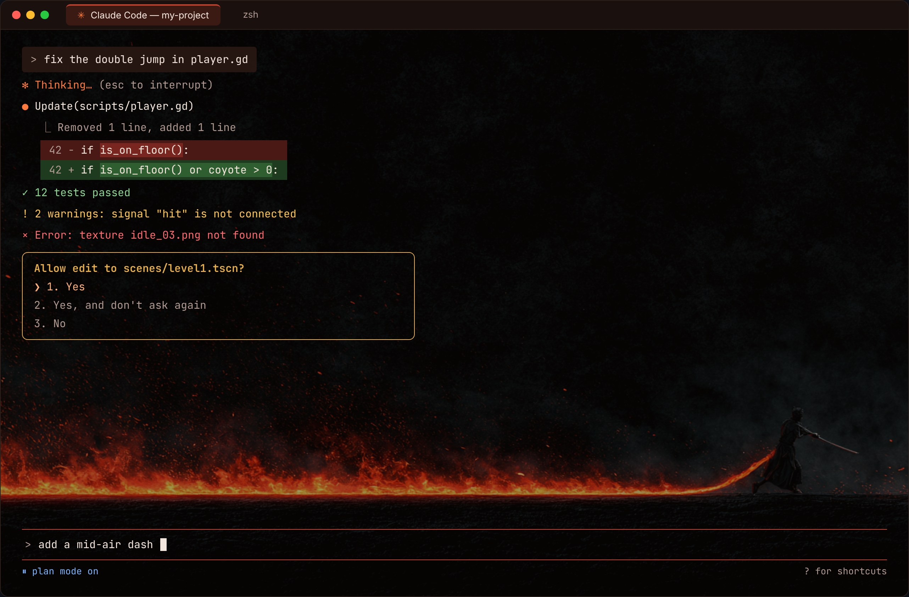
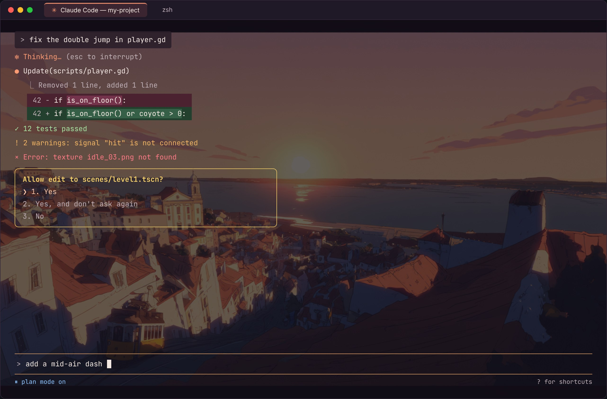
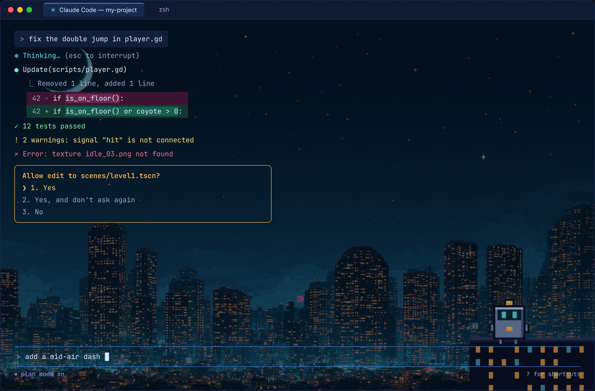
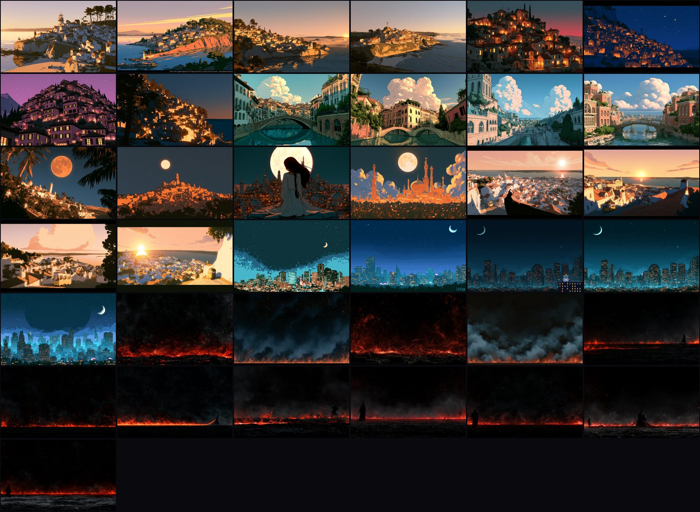

# Temas para o Claude Code + iTerm2

[English](README.md) · **Português**

Três temas para quem usa o **Claude Code** no **iTerm2** (Mac): uma imagem de fundo na janela do terminal e cores a combinar, tanto no terminal como no Claude Code.

Vêm também dois comandos para usar dentro do Claude Code:

- **`/tema`** troca o tema inteiro (fundo e cores) sem fechar nada.
- **`/fundo`** troca só a imagem de fundo.

## Como fica o terminal

### Rengoku
Brasas, fumo e um samurai diante do fogo. Laranja quente para o Claude, dourado nos pedidos de permissão.



### Lofi Cidades
Lisboa e cidades inventadas, do amanhecer à noite. Coral para o Claude, amarelo nos pedidos de permissão.



### Cidade Pixel
Uma cidade em pixel art à noite, com um robozinho sentado num telhado. Ciano para o Claude, âmbar nos pedidos de permissão.



<sub>Imagens ilustrativas. No teu Mac, o brilho do fundo depende do tamanho da janela e do controlo "Blending" do iTerm2.</sub>

## Todos os fundos

São 37 fundos ao todo: 12 do Rengoku, 20 da Lofi Cidades e 5 da Cidade Pixel (um deles com o robozinho). Há também versões mais escuras de dois deles, usadas como fundo padrão.



---

## O que precisas

- Um **Mac**.
- O **[iTerm2](https://iterm2.com)**. O Terminal normal do Mac não mostra imagens de fundo.
- O **[Claude Code](https://code.claude.com)**, versão 2.1.118 ou mais recente (a que trouxe os temas personalizados). Para ver a tua versão: `claude --version`.

## Como instalar

**1. Baixa esta pasta.** Escolhe uma das formas:

- **Com o Git**, no Terminal:
  ```bash
  git clone https://github.com/joaocalixto/temas-claude-code.git ~/temas-claude-code
  ```
- **Sem o Git:** carrega no botão verde **Code → Download ZIP**, abre o ZIP e põe a pasta num sítio fixo (por exemplo, a tua pasta pessoal).

> Não apagues nem mudes a pasta de lugar depois de instalar: as imagens de fundo são lidas dali. Se a mudares, corre o instalador outra vez.

**2. Corre o instalador.** Dentro da pasta, dá dois cliques em **`instalar.command`**.
Se o Mac disser que não o pode abrir, clica com o botão direito → **Abrir** → **Abrir**.
Também podes corrê-lo no Terminal: `~/temas-claude-code/instalar.command`.

**3. Abre o iTerm2.** Fecha e abre o iTerm2 (para ele ver a letra nova).
O instalador cria o perfil **"Claude · Último"** e põe-no como perfil padrão do iTerm2. Este perfil guarda o último tema e o último fundo que escolheste, por isso as abas e janelas novas abrem sempre igual.
Se o iTerm2 estava aberto durante a instalação, o instalador não consegue mudar o perfil padrão. Nesse caso faz isto uma vez: **Settings → Profiles**, seleciona **"Claude · Último"**, clica em **Other Actions… → Set as Default** e abre uma aba nova (**⌘T**).

**4. Escolhe o tema no Claude Code.** Fecha e abre o Claude Code (para ele ver os comandos novos) e escreve `/tema pixel` (ou `lofi`, ou `rengoku`).

Pronto. O `/tema` muda o iTerm2 e o Claude Code ao mesmo tempo, por isso não precisas do menu `/theme` do Claude Code.

## Como usar

Dentro do Claude Code:

| Comando | O que faz |
|---|---|
| `/tema pixel` | Muda para a Cidade Pixel |
| `/tema lofi` | Muda para a Lofi Cidades |
| `/tema rengoku` | Muda para o Rengoku |
| `/tema aleatorio` | Escolhe um dos três temas ao calhas |
| `/tema lista` | Mostra os temas |
| `/fundo lista` | Mostra todos os fundos |
| `/fundo lisboa 2` | Troca para o fundo que tem essas palavras no nome |
| `/fundo robo` | Volta à Cidade Pixel com o robozinho |
| `/fundo aleatorio` | Escolhe um fundo ao calhas |
| `/fundo nenhum` | Tira a imagem de fundo |
| `/tema-teste` | Mostra uma amostra de tudo o que o tema pinta: as 16 cores do terminal, estilos de texto, ícones, um diff de código, uma lista de tarefas, títulos, listas, uma tabela e blocos de código |

- O `/tema` e o `/fundo` mudam a aba onde estás na hora e guardam a escolha no perfil **"Claude · Último"**. As abas e janelas novas abrem com o último tema e o último fundo que escolheste (desde que esse perfil seja o padrão, ver passo 3).
- O `/tema` volta ao fundo próprio do tema. Se quiseres outro fundo nesse tema, usa o `/fundo` a seguir.
- O `/tema-teste` cria um pequeno arquivo de teste em `/tmp/tema-teste/` (fora do teu projeto), por isso o Claude Code pode pedir autorização: esse pedido também faz parte do teste.
- Na primeira vez que usares o `/fundo`, o iTerm2 pede autorização para mudar a imagem. Escolhe **Allow**.

## O que o tema muda

**No iTerm2** (os perfis "Claude · ..."):

- **Imagem de fundo**, escurecida o suficiente para as letras se lerem bem.
- **Cor da aba**, diferente em cada tema.
- **"Claude · Último"**, um perfil extra que copia o último tema e o último fundo que escolheste com o `/tema` e o `/fundo`.
- **As 16 cores do terminal**, as que o Git e os outros programas usam.
- **Cor do cursor e da seleção.**
- **Letra: JetBrains Mono Nerd Font**, a mesma das imagens. Vem na pasta `fonte/` e o instalador põe-na no teu Mac. Tem os ícones que prompts como o Powerlevel10k e o Oh My Zsh usam.
- O resto vem do teu perfil **Default**.

**No Claude Code:** as cores do Claude, da caixa onde escreves, dos pedidos de permissão, do modo plano, dos erros, dos avisos e das linhas novas e apagadas no código.

## Ajustes

- **Barra das abas igual às imagens:** em **iTerm2 → Settings → Appearance → General**, põe **Theme** em **Minimal**. Depois, em **Appearance → Tabs**, desliga **Stretch tabs to fill bar**. A barra de cima fica com a cor escura do terminal, e cada aba fica pequena, com a cor do tema. São opções do iTerm2 inteiro, por isso o instalador não as muda por ti.
- **A barra Chat / Diff / Code Review** por baixo das abas é do modo de ecrã inteiro do Claude Code, não do tema.
- **Fundo muito claro ou muito escuro:** em **iTerm2 → Settings → Profiles → (o perfil) → Window**, mexe no controlo **Blending**.
- **Mudar o fundo padrão de um tema:** em `iterm2/temas-claude-code.json`, troca a linha `"Background Image Location"` desse perfil por outra imagem da pasta `imagens/`. Depois corre o `instalar.command` de novo.
- **Mudar as cores do Claude Code:** edita o tema em `claude-code/themes/`. Os nomes das cores estão na [documentação do Claude Code](https://code.claude.com/docs/en/terminal-config#create-a-custom-theme).

## Desinstalar

Dá dois cliques em **`desinstalar.command`**. Se o Claude Code estava num destes temas, volta ao tema escuro normal. No iTerm2, escolhe outro perfil padrão em **Settings → Profiles** (o "Claude · Último" deixa de existir).

## O que há nesta pasta

```
instalar.command        instala tudo (dois cliques)
desinstalar.command     remove tudo
tema.sh                 o que o /tema corre
fundo.sh                o que o /fundo corre
lembrar.sh              guarda o último tema e fundo no perfil "Claude · Último"
amostra.sh              a amostra de cores que o /tema-teste mostra
fonte/                  a letra JetBrains Mono Nerd Font (licença OFL)
claude-code/themes/     as cores do Claude Code (um arquivo por tema)
claude-code/commands/   os comandos /tema e /fundo
iterm2/                 os três perfis do iTerm2
imagens/                os fundos, cada um com o prompt num .txt ao lado
docs/                   as imagens deste README
```

## Como funciona (para curiosos)

- Os perfis do iTerm2 são **perfis dinâmicos**: um arquivo em `~/Library/Application Support/iTerm2/DynamicProfiles/` que o iTerm2 lê sozinho.
- Os temas do Claude Code vão para `~/.claude/themes/`. O `/tema` escolhe um deles escrevendo `"theme": "custom:<nome>"` em `~/.claude/settings.json` (só essa linha; o resto fica como estava). O Claude Code relê esse arquivo sozinho, por isso as cores mudam na hora.
- Para mudar a janela, o `/tema` e o `/fundo` usam os códigos próprios do iTerm2 (`SetProfile` e `SetBackgroundImageFile`), enviados para a janela onde o Claude Code está aberto.
- Para as abas novas, os dois comandos reescrevem um segundo perfil dinâmico, `claude-ultimo.json`. Esse perfil diz só duas coisas: de que tema herda tudo (`Dynamic Profile Parent Name`) e, se usaste o `/fundo`, qual é a imagem. O iTerm2 nota a mudança no arquivo e atualiza o perfil sozinho.

## Créditos

- Fundos gerados com o **Midjourney**. O prompt de cada imagem está no `.txt` ao lado dela.
- O robozinho da Cidade Pixel foi desenhado à mão, pixel a pixel.
- Feito por **João Chagas**, com a ajuda do Claude.

Licença **MIT**: podes usar, mudar e partilhar à vontade. Vê o arquivo [LICENSE](LICENSE).

